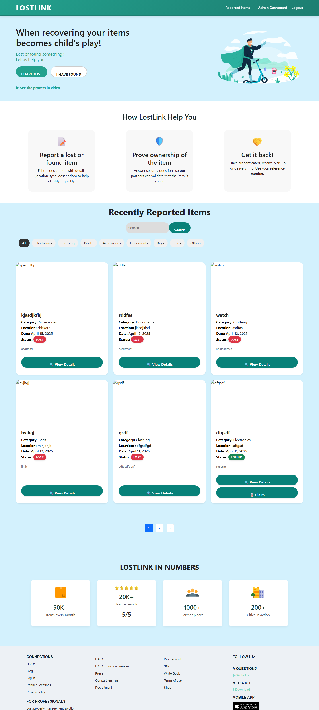
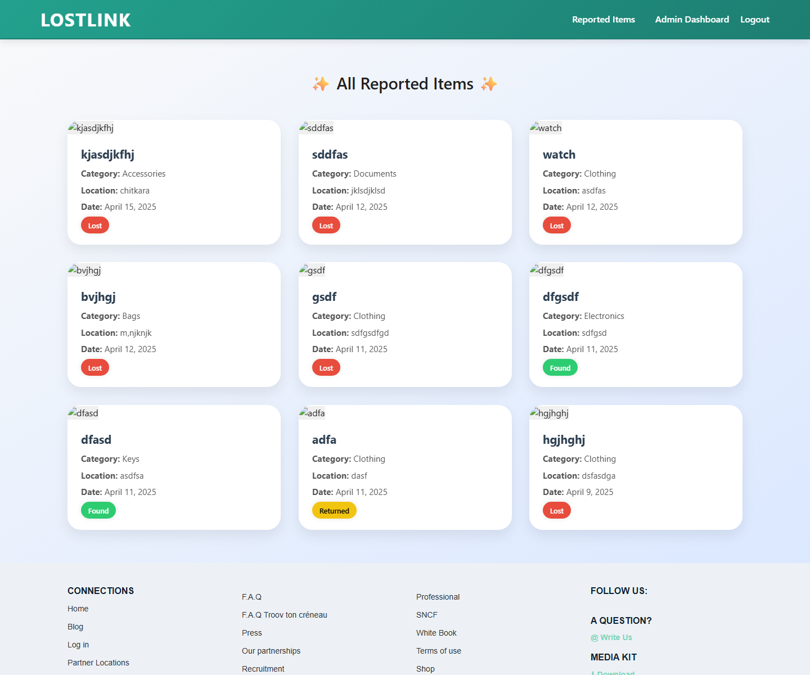
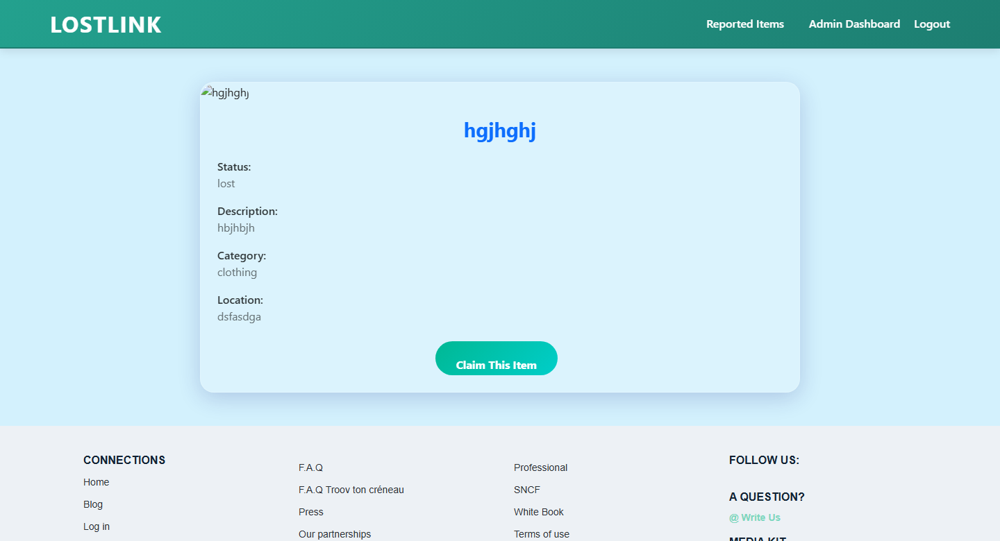
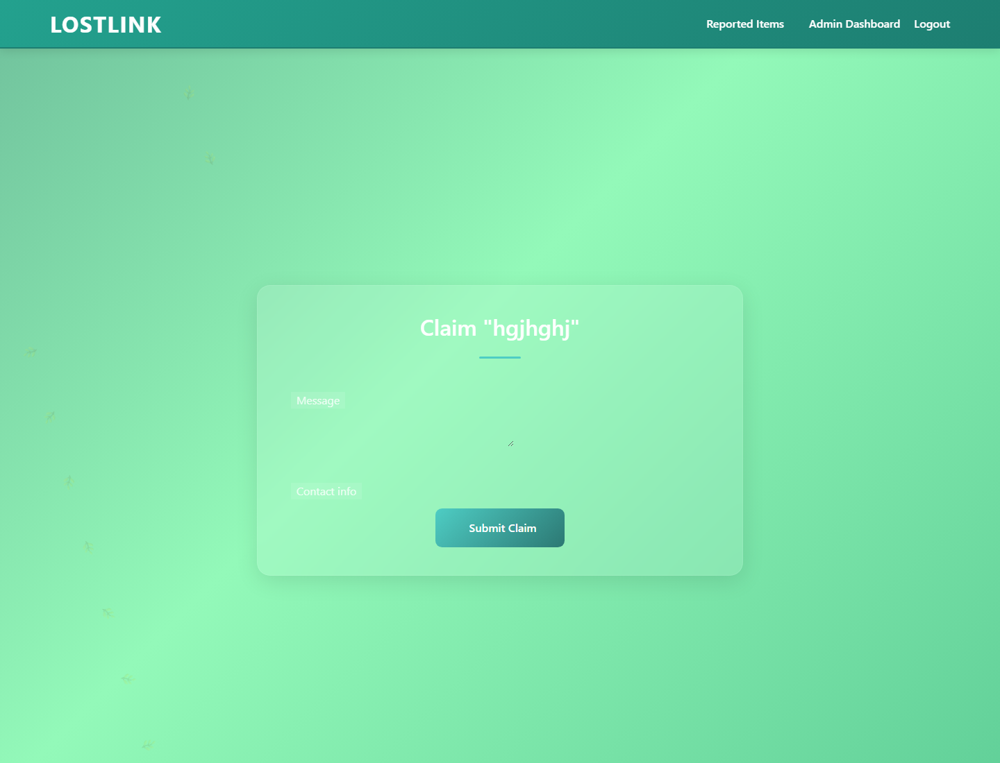
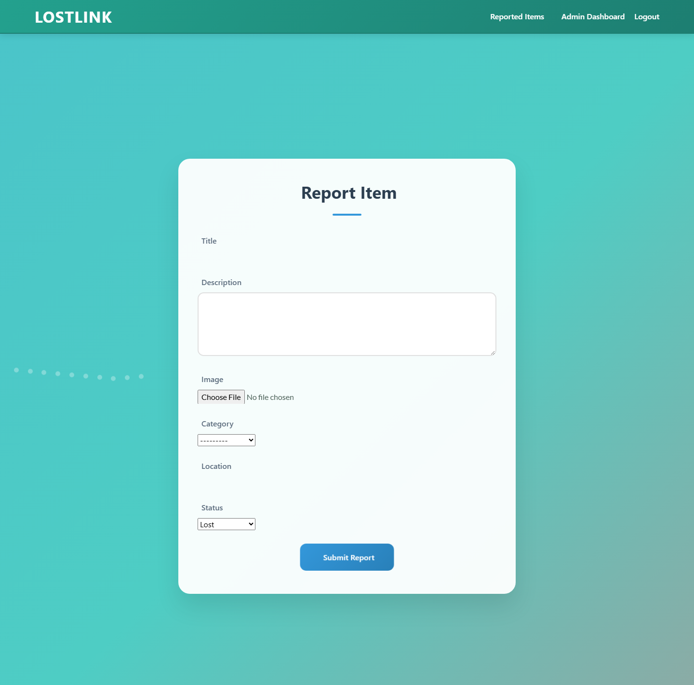
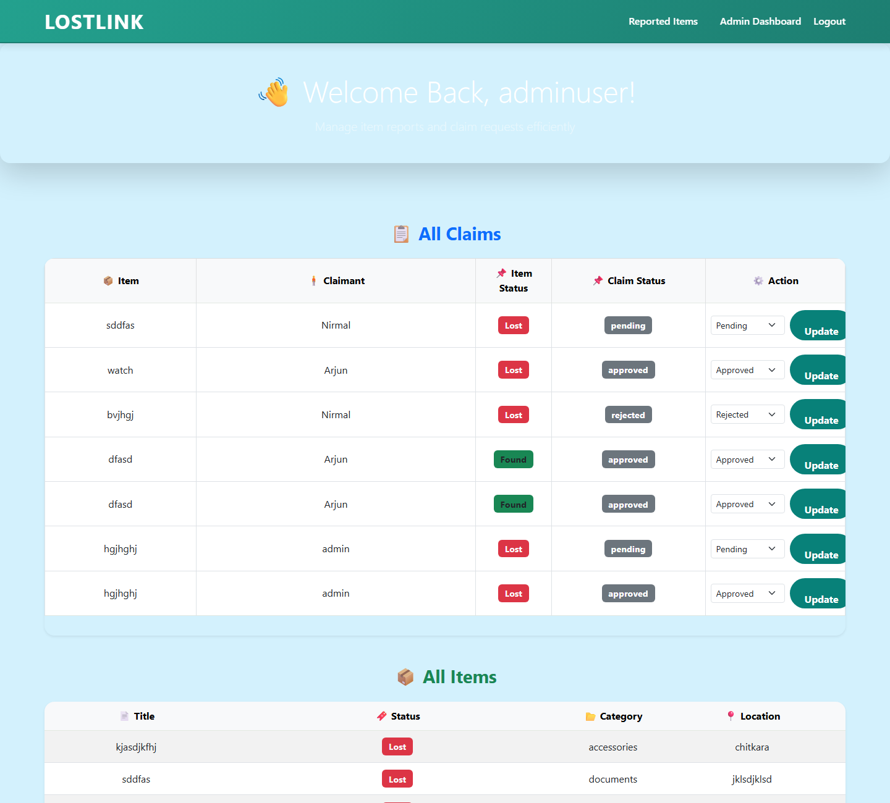
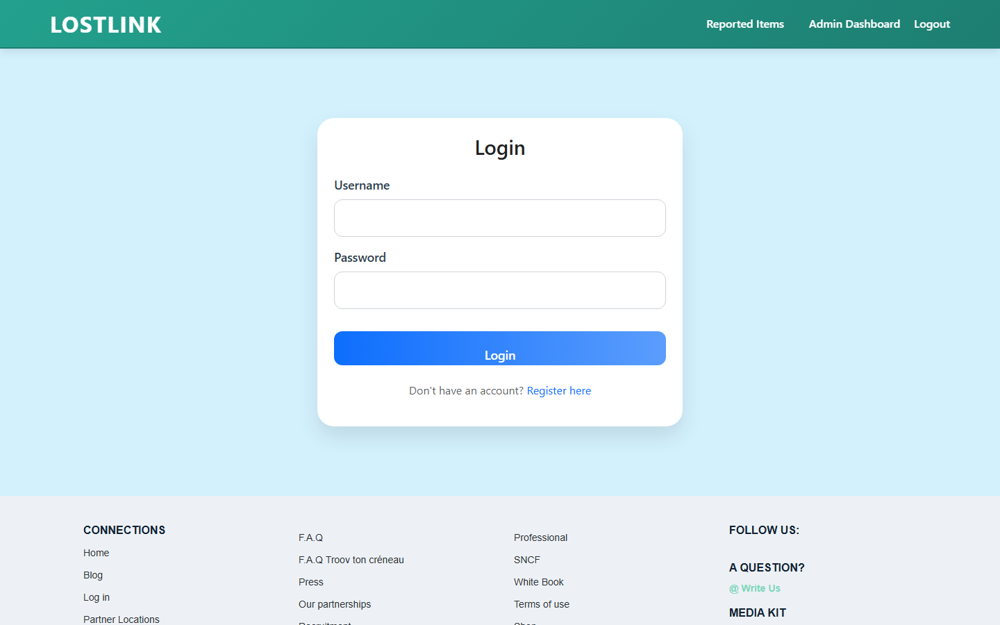
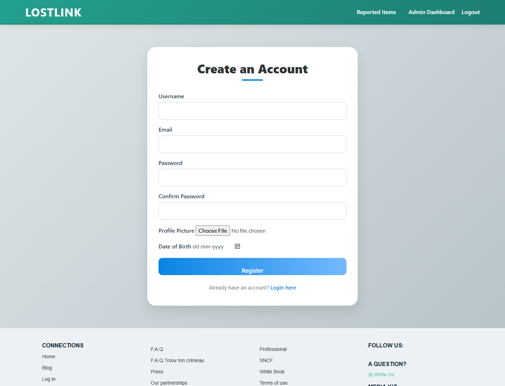

# 🎒 LostLink — Lost & Found Web Application

**LostLink** is a full-stack **Django web application** that makes it easy to report, search, claim, and recover lost items. Users can report items they have lost or found, browse a public gallery of reported items, submit claim requests, and let admins verify and approve claims — bringing lost belongings back to their owners.

---

## ✨ Features

| Feature | Description |
|---|---|
| 🔐 **User Authentication** | Register, log in, and log out with a custom user model (profile picture, phone, address, bio) |
| 📝 **Report Items** | Report a lost or found item with title, description, photo, category, and location |
| 🖼️ **Item Gallery** | Browse all reported items with **search**, **category filters**, and **pagination** |
| 🔍 **Item Detail Pages** | Full details of every reported item with status badges (Lost / Found / Returned) |
| 🙋 **Claim Requests** | Claim a found item by submitting a message and contact info |
| 🛡️ **Admin Dashboard** | Admins view all items and claims, and approve / reject / update claim statuses |
| 👤 **Role-Based Access** | Separate views and permissions for admins and normal users |
| 📊 **Dashboard & Stats** | Home dashboard with recently reported items and platform stats |

---

## 🖼️ Screenshots

### 🏠 Home Dashboard
Browse recently reported items, search by keyword, and filter by category.



### 📋 All Reported Items
A complete gallery of every reported item with live status badges.



### 📦 Item Detail & Claiming
View full item details and submit a claim directly from the item page.



### 🙋 Submit a Claim
Claimants describe the item and leave contact information for verification.



### 📝 Report a Lost/Found Item
Simple form to report a new item with photo upload.



### 🛡️ Admin Dashboard
Admins manage all claims (approve/reject/pending) and monitor every item.



### 🔑 Login & Register
Clean authentication pages powered by Django auth.

| Login | Register |
|---|---|
|  |  |

---

## 🛠️ Tech Stack

- **Backend:** Python 3, Django 5.2
- **Database:** SQLite 3
- **Frontend:** HTML5, CSS3, Bootstrap 5, AOS (animate-on-scroll), Google Fonts
- **Image Handling:** Pillow (for `ImageField` uploads)

---

## 📂 Project Structure

```
lost_and_found_system/
├── realApp/                 # Django project
│   ├── manage.py
│   ├── requirements.txt
│   ├── db.sqlite3           # (auto-created after migrations)
│   ├── realApp/             # Project settings & URLs
│   ├── MainApp/             # Items, claims, dashboards (main app)
│   │   ├── models.py        # Item & ClaimRequest models
│   │   ├── views.py
│   │   ├── forms.py
│   │   ├── urls.py
│   │   └── templates/
│   └── users/               # Custom user model & auth pages
│       ├── models.py        # CustomUser (profile, roles)
│       ├── views.py
│       └── templates/users/
├── screenshots/             # App screenshots used in this README
└── README.md
```

---

## 🚀 Getting Started

### Prerequisites
- Python 3.12+
- pip

### Installation

```bash
# 1. Clone the repository
git clone https://github.com/Akshat-hub7/LostLink-Django.git
cd LostLink-Django/realApp

# 2. Create & activate a virtual environment
python -m venv env
# Windows:
env\Scripts\activate
# macOS/Linux:
source env/bin/activate

# 3. Install dependencies
pip install -r requirements.txt

# 4. Apply database migrations
python manage.py migrate

# 5. Start the development server
python manage.py runserver
```

Then open **http://127.0.0.1:8000/** in your browser. 🎉

### 🔑 Creating an Admin Account

This project promotes the user **`adminuser`** to an admin automatically. To create one:

```bash
python manage.py shell
```

```python
from users.models import CustomUser
u = CustomUser(username="adminuser", email="admin@example.com")
u.set_password("supersecret123")
u.save()
```

Or register through the app using the username `adminuser` and password `supersecret123` — the account is promoted to admin automatically on save.

> ⚠️ **Note:** These credentials are hard-coded for demo purposes only. Do **not** use them in production.

---

## 🔗 Main URLs

| URL | Page | Access |
|---|---|---|
| `/` | Home dashboard & item gallery | Login required |
| `/items/` | My reported items | Login required |
| `/add-item/` | Report a new item | Login required |
| `/item/<id>/` | Item detail | Public |
| `/item/<id>/claim/` | Claim an item | Login required |
| `/claims/` | My claim requests | Login required |
| `/admin-dashboard/` | Admin panel (items + claims) | Admin only |
| `/reported-items/` | All reported items | Login required |
| `/login/` `/register/` `/logout/` | Authentication | Public |

---

## 📈 Future Improvements

- 🔔 Email / in-app notifications when a claim is approved
- 🗺️ Map-based location picker for reported items
- 💬 Real-time chat between claimant and reporter
- 🌍 Deployment guide (PostgreSQL, environment-based secrets)

---

## 👤 Author

**Akshat Choudhary**
- GitHub: [@Akshat-hub7](https://github.com/Akshat-hub7)

---

## 📄 License

This project is available for educational purposes. Feel free to fork and improve it!
